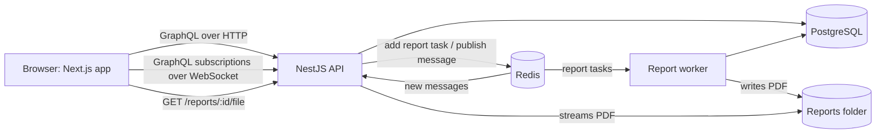

# Home Renovation Project Tracker

A backend for contractors and homeowners collaborating on renovation jobs: jobs and their
homeowners, a chat per job, a full change history with undo and redo, real-time messages, and
PDF reports built in the background. A small Next.js app shows it working end to end.

**Stack:** Node 24, TypeScript, NestJS 12, GraphQL (Apollo, code-first), PostgreSQL 18 with
TypeORM 1, Redis 8 with BullMQ, Next.js 16 with TanStack Query, Tailwind and shadcn/ui.

## Run it

You need Node 24.15+ (`nvm use`), pnpm 12.9 (`corepack enable`) and Docker.

```bash
pnpm install
cp api/.env.example api/.env
cp app/.env.example app/.env.local
pnpm infra:up                     # Postgres, test Postgres and Redis in Docker
pnpm --filter api migration:run
pnpm --filter api seed            # demo users, jobs, history and 5,000 messages
```

Then, in three terminals (start the API first: it compiles the code the worker runs):

```bash
pnpm dev:api      # GraphQL API and GraphiQL on http://localhost:4000/graphql
pnpm dev:worker   # builds PDF reports in the background
pnpm dev:app      # web app on http://localhost:3000
```

### Demo accounts

Every password is `password123`.

| Username | Role | Jobs |
| --- | --- | --- |
| `carlos` | Contractor | Kitchen remodel, Basement finish (large: 300 edits, 5,000 messages) |
| `diana` | Contractor | Primary bathroom (left with an undone edit, so redo is available) |
| `hannah` | Homeowner | Kitchen, Basement |
| `henry` | Homeowner | Kitchen |
| `hugo` | Homeowner | Bathroom |

`pnpm --filter api seed` resets the database to this state at any time.

## Architecture



- **API** (`api/src/main.ts`): GraphQL for everything, plus one REST route to download PDFs,
  because binary files do not fit GraphQL's JSON responses.
- **Worker** (`api/src/worker.ts`): a separate process that takes report tasks off the BullMQ
  queue, so the API never spends time building PDFs.
- **Redis** carries the report queue and the pub/sub for live messages. Pub/sub through Redis
  (not process memory) means a message sent through one API instance reaches subscribers on
  every instance; an e2e test runs two instances to prove it.

## Using the API

Open GraphiQL at http://localhost:4000/graphql, or use curl. Log in:

```bash
curl -s http://localhost:4000/graphql -H 'Content-Type: application/json' \
  -d '{"query":"mutation { login(input: {username: \"carlos\", password: \"password123\"}) { accessToken } }"}'
```

Send the token as `Authorization: Bearer <token>` on every other request (in GraphiQL, under
Headers). For subscriptions, send it in the WebSocket `connectionParams` as
`{ "authorization": "Bearer <token>" }`.

| Operation | Who | What it does |
| --- | --- | --- |
| `jobs`, `job(id)` | both roles | Contractors see their jobs; homeowners see the jobs they are on |
| `createJob`, `updateJob`, `deleteJob` | contractor | `updateJob` takes `expectedVersion`; deleting is a soft delete |
| `addHomeowner(jobId, username)`, `removeHomeowner` | contractor | |
| `jobHistory(jobId)` | both roles | Every change, oldest first, with who made it and a readable summary |
| `undoJobChange(jobId)`, `redoJobChange(jobId)` | contractor | Also take `expectedVersion` |
| `messages(jobId, after, limit)`, `sendMessage` | both roles | `after` fetches only newer messages, for catching up |
| `messageAdded(jobId)` (subscription) | both roles | New messages as they are sent |
| `requestReport(jobId)`, `reportExport(id)` | contractor | Starts a PDF in the background; poll until `DONE` |
| `GET /reports/:exportId/file` | contractor | Downloads the finished PDF |

An example: edit a job, then undo it.

```graphql
mutation {
  updateJob(id: "<job id>", input: { costCents: 2600000, expectedVersion: 3 }) { version costCents }
}

mutation {
  undoJobChange(jobId: "<job id>") { version costCents canUndo canRedo }
}
```

Errors carry a stable `extensions.code`: `UNAUTHENTICATED`, `FORBIDDEN`, `NOT_FOUND`,
`BAD_REQUEST` (with field `details`), or `CONFLICT`.

## Key decisions

- **History as a change log with undo states.** `jobs` holds the current state; `job_changes`
  is an append-only log, numbered per job, where each edit stores only the fields it changed as
  `{ from, to }`. Undo writes back `from`, redo writes `to`. Each edit is `APPLIED`, `UNDONE` or
  `DISCARDED` (undone, then replaced by a new edit), like an editor's undo and redo stacks.
  Nothing is deleted, so the log is a full audit trail. Full event sourcing would complicate
  every read for four fields; snapshots would not read as naturally as diffs.
- **Data integrity.** Every change runs in one transaction with the job row locked, so changes
  to a job happen one at a time, and the change and its history entry are saved together or
  not at all. `expectedVersion` rejects edits and undos made from an out-of-date view. Undo
  refuses if the job no longer matches its history. Constraints live in the database: unique
  change numbers per job, check constraints on the history rules, non-negative costs.
- **Report export is asynchronous.** The API saves the request and queues a task; the worker
  builds the PDF, reading rows in pages so memory stays flat on large jobs. Postgres and Redis
  cannot share a transaction, so the task id is the export id (re-adding is harmless), a failed
  enqueue marks the export `FAILED`, and the worker re-queues exports stuck in `QUEUED` on
  startup. A partial unique index allows one active export per job, so repeated clicks return
  the same export.
- **Money is integer cents**, never floats.
- **"Not found" instead of "forbidden"** for jobs you cannot access, so ids reveal nothing.

## The web app

A deliberately small client: log in, list jobs, create, edit and delete them, manage homeowners,
browse history with undo and redo, chat in real time, and export the PDF. Homeowners get a
read-only view with the chat.

- The access token is kept in `localStorage`: simple, and it works for both HTTP and the
  WebSocket. The trade-off is that a cross-site scripting bug could read it; an httpOnly cookie
  would need every request, including the WebSocket, to go through a proxy.
- Forms use react-hook-form with Zod. Costs are typed in dollars and sent as cents.
- The chat shows the latest 50 messages and catches up with `after` whenever the WebSocket
  reconnects.
- The frontend has no automated tests, by choice; the API has unit and e2e tests.

## Tests

```bash
pnpm --filter api test        # unit tests
pnpm --filter api test:e2e    # e2e tests against the test Postgres and Redis (pnpm infra:up)
```

The e2e suite covers the access rules for each role, undo and redo (including concurrent
changes, stale versions and changes made outside the log), real-time delivery across two API
instances, and a full report export through the real worker. CI runs lint, formatting,
typechecks, both test suites and a check that the entities match the migrations, and builds the
web app.

## Assumptions and cuts

- Users are seeded; there is no sign-up, password reset or refresh token. Tokens last an hour.
- Undo and redo cover job fields (description, address, status, cost). Membership changes and
  deletion are recorded in the history but cannot be undone. Undo may move the status
  backwards, since it restores an earlier valid state.
- Report files are kept on local disk. In production they would go to object storage (S3) with
  short-lived download links.
- A homeowner removed from a job keeps receiving its live messages until they reconnect.

## With more time

- A `reportReady` subscription instead of polling, and clean-up of old report files.
- Batching the per-job field lookups with DataLoader, and cursor paging backwards for messages.
- Docker images for the API, worker and web app, for a one-command start.
- Frontend tests for the main flows.

## How I used AI

<!-- Write this section yourself: which tools you used, what they did, what you designed and
     reviewed by hand, and one thing the AI got wrong that you caught. -->
