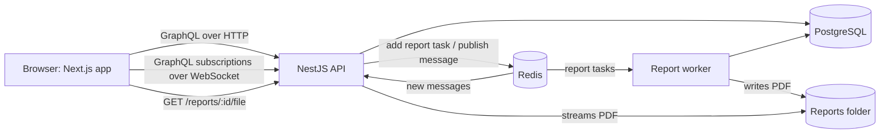

# Home Renovation Project Tracker

A full-stack monorepo where contractors and homeowners collaborate on renovation jobs: a NestJS GraphQL API, a background report worker, and a Next.js web app, backed by PostgreSQL and Redis.

## Features

- Jobs and their homeowners
- A chat per job, with real-time messages
- A full change history with undo and redo
- PDF reports built in the background

**Stack:** Node 24, TypeScript, NestJS 12, GraphQL (Apollo, code-first), PostgreSQL 18 with
TypeORM 1, Redis 8 with BullMQ, Next.js 16 with TanStack Query, Tailwind and shadcn/ui.

## Setup & Run Instructions

You need Node 24.15+ (`nvm use`), pnpm 12.9 (`corepack enable`) and Docker.

```bash
pnpm install
cp api/.env.example api/.env
cp app/.env.example app/.env.local
pnpm infra:up                     # Postgres, test Postgres and Redis in Docker
pnpm --filter api migration:run
pnpm --filter api seed            # demo users, jobs, history and 5,000 messages
```

Then, in three terminals, in any order (the worker runs the code the API compiles, and waits for
it on a fresh clone):

```bash
pnpm dev:api      # GraphQL API and GraphiQL on http://localhost:4000/graphql
pnpm dev:worker   # builds PDF reports in the background
pnpm dev:app      # web app on http://localhost:3000
```

### Demo accounts

Every password is `password123`. `pnpm --filter api seed` resets the database to this state at any time.

| Username | Role       | Jobs                                                                |
| -------- | ---------- | ------------------------------------------------------------------- |
| `carlos` | Contractor | Kitchen remodel, Basement finish (large: 300 edits, 5,000 messages) |
| `diana`  | Contractor | Primary bathroom (left with an undone edit, so redo is available)   |
| `hannah` | Homeowner  | Kitchen, Basement                                                   |
| `henry`  | Homeowner  | Kitchen                                                             |
| `hugo`   | Homeowner  | Bathroom                                                            |

## Architecture



- **API** (`api/src/main.ts`): GraphQL for everything, plus one REST route to download PDFs,
  because binary files do not fit GraphQL's JSON responses.
- **Worker** (`api/src/worker.ts`): a separate process that takes report tasks off the BullMQ
  queue, so the API never spends time building PDFs.
- **Redis** carries the report queue and the pub/sub for live messages. Because pub/sub goes
  through Redis rather than process memory, a message sent through one API instance reaches
  subscribers on every instance (an e2e test runs two instances to prove it).

## API usage examples

The API is at http://localhost:4000/graphql. Use GraphiQL (open that URL in a browser), Postman,
or curl. All examples below were run against the seeded database.

### Authentication

Log in, then send the token as `Authorization: Bearer <token>` on every other request (in
GraphiQL, under Headers). Subscriptions run over a WebSocket, which cannot carry headers, so they
send `{ "authorization": "Bearer <token>" }` in the connection payload (`connectionParams`).

### Operations

| Operation                                      | Who        | What it does                                                        |
| ---------------------------------------------- | ---------- | ------------------------------------------------------------------- |
| `login(input)`                                 | anyone     | Returns an access token valid for one hour                          |
| `jobs`, `job(id)`                              | both roles | Contractors see their jobs; homeowners see the jobs they are on     |
| `createJob`, `updateJob`, `deleteJob`          | contractor | `updateJob` takes `expectedVersion`; deleting is a soft delete      |
| `addHomeowner`, `removeHomeowner`              | contractor | Manage who can see a job                                            |
| `jobHistory(jobId)`                            | both roles | Every change, oldest first, with who made it and a readable summary |
| `undoJobChange`, `redoJobChange`               | contractor | Also take `expectedVersion`                                         |
| `messages(jobId, after, limit)`, `sendMessage` | both roles | `after` fetches only newer messages, for catching up                |
| `messageAdded(jobId)` (subscription)           | both roles | New messages as they are sent                                       |
| `requestReport(jobId)`, `reportExport(id)`     | contractor | Starts a PDF in the background; poll until `DONE`                   |
| `GET /reports/:exportId/file`                  | contractor | Downloads the finished PDF                                          |

Errors carry a stable `extensions.code`: `UNAUTHENTICATED`, `FORBIDDEN`, `NOT_FOUND`,
`BAD_REQUEST` (with field `details`), or `CONFLICT`.

### Walkthrough with curl

Paste this into a terminal (bash or zsh) while the API and worker are running. It creates a job,
edits it, undoes and redoes the edit, reads the history, sends a message and downloads the PDF.

```bash
API=http://localhost:4000

# Log in as a contractor and keep the access token.
TOKEN=$(curl -s "$API/graphql" -H 'Content-Type: application/json' \
  -d '{"query":"mutation { login(input: { username: \"carlos\", password: \"password123\" }) { accessToken } }"}' \
  | sed -E 's/.*"accessToken":"([^"]+)".*/\1/')

# gql '<operation>' [id]: sends one GraphQL operation as that user; the id (default $JOB_ID)
# is passed as the $id variable.
gql() {
  curl -s "$API/graphql" -H 'Content-Type: application/json' -H "Authorization: Bearer $TOKEN" \
    -d "{\"query\":\"$1\",\"variables\":{\"id\":\"${2:-$JOB_ID}\"}}"
  echo
}

# Create a job ($1,500.00 is 150000 cents) and keep its id.
JOB_ID=$(gql 'mutation { createJob(input: { description: \"New deck\", address: \"9 Oak Ave\", costCents: 150000 }) { id } }' \
  | sed -E 's/.*"id":"([^"]+)".*/\1/')

# List your jobs.
gql '{ jobs { id description status costCents version } }'

# Add a homeowner.
gql 'mutation ($id: ID!) { addHomeowner(jobId: $id, username: \"hannah\") { homeowners { username } } }'

# Edit the job. expectedVersion is the version you last read; a stale one returns CONFLICT.
gql 'mutation ($id: ID!) { updateJob(id: $id, input: { costCents: 175000, status: IN_PROGRESS, expectedVersion: 1 }) { status costCents version } }'
gql 'mutation ($id: ID!) { updateJob(id: $id, input: { costCents: 180000, expectedVersion: 1 }) { version } }'

# Undo the edit, then redo it.
gql 'mutation ($id: ID!) { undoJobChange(jobId: $id) { status costCents canUndo canRedo } }'
gql 'mutation ($id: ID!) { redoJobChange(jobId: $id) { status costCents canUndo canRedo } }'

# Read the history (homeowners on the job can read it too).
gql 'query ($id: ID!) { jobHistory(jobId: $id) { changeNumber type state summary responsibleUser { username } } }'

# Send a message, then read the latest messages.
gql 'mutation ($id: ID!) { sendMessage(input: { jobId: $id, body: \"Materials arrive Monday\" }) { id body } }'
gql 'query ($id: ID!) { messages(jobId: $id, limit: 10) { body author { username } createdAt } }'

# Request the PDF report. The worker builds it in the background; poll until DONE.
EXPORT_ID=$(gql 'mutation ($id: ID!) { requestReport(jobId: $id) { id } }' | sed -E 's/.*"id":"([^"]+)".*/\1/')
sleep 2
gql 'query ($id: ID!) { reportExport(id: $id) { status downloadPath } }' "$EXPORT_ID"

# Download it (the one REST route).
curl -s -o job-report.pdf -H "Authorization: Bearer $TOKEN" "$API/reports/$EXPORT_ID/file"
```

Some of the responses:

```jsonc
// updateJob
{"data":{"updateJob":{"status":"IN_PROGRESS","costCents":175000,"version":2}}}

// updateJob again with the stale expectedVersion: 1
{"errors":[{"message":"The job changed since you loaded it (version 1, now 2). Reload and try again.",
  "extensions":{"code":"CONFLICT"}}],"data":null}

// undoJobChange
{"data":{"undoJobChange":{"status":"PLANNING","costCents":150000,"canUndo":false,"canRedo":true}}}

// jobHistory (first entries)
{"data":{"jobHistory":[
  {"changeNumber":1,"type":"CREATE","state":null,"summary":"status: PLANNING; address: 9 Oak Ave; cost: $1,500.00; description: New deck","responsibleUser":{"username":"carlos"}},
  {"changeNumber":2,"type":"HOMEOWNER_ADDED","state":null,"summary":"homeowner: hannah","responsibleUser":{"username":"carlos"}},
  {"changeNumber":3,"type":"UPDATE","state":"APPLIED","summary":"status: PLANNING -> IN_PROGRESS; cost: $1,500.00 -> $1,750.00","responsibleUser":{"username":"carlos"}},
  {"changeNumber":4,"type":"UNDO","state":null,"summary":"status: IN_PROGRESS -> PLANNING; cost: $1,750.00 -> $1,500.00","responsibleUser":{"username":"carlos"}}
]}}
```

### GraphQL operations for GraphiQL or Postman

Paste an operation into the editor and its variables into the Variables panel.

```graphql
mutation Login($input: LoginInput!) {
  login(input: $input) {
    accessToken
    user { id username role }
  }
}
# Variables: { "input": { "username": "carlos", "password": "password123" } }

query Job($id: ID!) {
  job(id: $id) {
    id description address status costCents version canUndo canRedo
    contractor { username }
    homeowners { username }
  }
}

mutation UpdateJob($id: ID!, $input: UpdateJobInput!) {
  updateJob(id: $id, input: $input) { id status costCents version }
}
# Variables: { "id": "<job id>", "input": { "costCents": 250000, "status": "IN_PROGRESS", "expectedVersion": 1 } }

mutation Undo($jobId: ID!) {
  undoJobChange(jobId: $jobId) { costCents version canUndo canRedo }
}

query History($jobId: ID!) {
  jobHistory(jobId: $jobId) {
    changeNumber type state summary createdAt
    responsibleUser { username }
  }
}

mutation RequestReport($jobId: ID!) {
  requestReport(jobId: $jobId) { id status }
}

query ReportStatus($id: ID!) {
  reportExport(id: $id) { status downloadPath error }
}

# Real-time: keep this running in one tab, then send a message from another
# (log in as hannah there to see it arrive from a different user).
subscription Messages($jobId: ID!) {
  messageAdded(jobId: $jobId) {
    body createdAt
    author { username role }
  }
}
```

GraphiQL cannot send `connectionParams`, so it runs queries and mutations but not the
authenticated subscription. For that, use Postman (below) or the web app.

### Postman

- **Queries and mutations:** create a GraphQL request to `http://localhost:4000/graphql`. Postman
  reads the schema from the API, so you can browse the operations. Set **Authorization** to
  *Bearer Token* with the token from `login`.
- **The subscription:** create a WebSocket request to `ws://localhost:4000/graphql` with the
  header `Sec-WebSocket-Protocol: graphql-transport-ws`, connect, then send these two messages in
  order. The first authenticates the connection; after the server answers `connection_ack`, the
  second subscribes, and each new message on the job arrives as a `next` message.

```json
{ "type": "connection_init", "payload": { "authorization": "Bearer <token>" } }
```

```json
{ "id": "1", "type": "subscribe", "payload": { "query": "subscription { messageAdded(jobId: \"<job id>\") { body author { username } } }" } }
```

## Key assumptions

- **History as a change log with undo states.** `jobs` holds the current state; `job_changes`
  is an append-only log, numbered per job, that stores only the changed fields as
  `{ from, to }`. Undo writes back `from`, redo writes `to`. Each edit is `APPLIED`, `UNDONE` or
  `DISCARDED` (undone, then replaced by a new edit), like an editor's undo stack. Nothing is
  deleted, so the log doubles as an audit trail. Full event sourcing would complicate every read
  for four fields, and snapshots read less naturally than diffs.
- **Data integrity.** Each change runs in one transaction with the job row locked, so the
  change and its history entry are saved together or not at all. `expectedVersion` rejects edits
  and undos made from a stale view, and undo refuses if the job no longer matches its history.
  The database enforces unique change numbers per job, the history rules, and non-negative costs.
- **Asynchronous report export.** The API saves the request and queues a task; the worker
  builds the PDF, reading rows in pages so memory stays flat on large jobs. Postgres and Redis
  cannot share a transaction, so the task id is the export id (re-adding is harmless), a failed
  enqueue marks the export `FAILED`, and the worker re-queues exports stuck in `QUEUED` on
  startup. A partial unique index allows one active export per job, so repeated clicks return
  the same export.
- **Money is integer cents**, never floats.
- **"Not found" instead of "forbidden"** for jobs you cannot access, so ids reveal nothing.

## Web app

Contractors can log in, manage jobs and homeowners, browse history with undo and redo, chat in
real time, and export PDFs. Homeowners get a read-only view plus the chat.

- The access token lives in `localStorage`: simple, and it works for both HTTP and the
  WebSocket. The trade-off is exposure to cross-site scripting; an httpOnly cookie would need
  every request, including the WebSocket, to go through a proxy.
- Forms use React Hook Form with Zod. Costs are typed in dollars and sent as cents.
- The chat shows the latest 50 messages and catches up with `after` when the WebSocket reconnects.

## Tests

```bash
pnpm --filter api test        # unit tests
pnpm --filter api test:e2e    # e2e tests against the test Postgres and Redis (needs pnpm infra:up)
```

The e2e suite covers role-based access, undo and redo (including concurrent changes, stale
versions and changes made outside the log), real-time delivery across two API instances, and a
full report export through the real worker. CI runs lint, formatting, typechecks, both test
suites, a check that entities match the migrations, and a web app build.

## My scope decisions

- Users are seeded: no sign-up, password reset or refresh tokens. Tokens last an hour.
- Undo and redo only cover job fields (description, address, status, cost).
- Adding or removing homeowners is recorded in the history but cannot be undone.
- Report files are kept on local disk. In production they would go to object storage (such as
  AWS S3) with short-lived download links.
- A homeowner removed from a job keeps receiving its live messages until they reconnect.

## With more time

- A `reportReady` subscription instead of polling, and clean-up of old report files.
- Batching per-job field lookups with DataLoader, and cursor paging backwards for messages.
- Docker images for the API, worker and web app, for a one-command start.

## How I used AI

- **Research:** I used it to explore the problem space and the technology options.
- **Planning:** I used it to criticize / find gaps in my plan and to break large features into small tasks.
- **Review:** I used it to challenge my technical decisions.
- **Writing:** I used it to produce boilerplate, features, tests, PR descriptions and documentation.
- **Troubleshooting:** I used it combined with logs to identify error root cause and come up with proposed solutions.

## What I decided myself

- **Scope:** I cut features that would add delivery time, and went beyond the brief where it paid off, such as building a monorepo with backend and frontend.
- **Stack:** I chose it from my own experience and industry knowledge, and rejected AI suggestions that relied on outdated training data.
- **Simplicity:** I rejected over-engineered AI proposals for simple features and deliberately traded scalability for the scope of this project.
- **Models:** I matched the model to the task: stronger/slower models where a mistake was expensive,
  and faster/cheaper where the work is high-volume or easy to check.

## How I use AI models

- **Research:** Perplexity for discovery, because every answer is cited and I can open
  the sources. Claude Sonnet 5.5 to synthesize and critique what I found.
- **Architecture and product decisions:** Claude Opus 5.5, because these choices are
  the hardest to reverse. I use it to challenge my plans and find gaps, but I make the
  final call.
- **Coding:** Claude Sonnet 5.5, for the best balance of quality and cost. All output
  goes through my review, typechecks, lint and tests.
- **Documentation and small tasks:** GPT 6, because the output is easy to
  verify and the volume is high.
